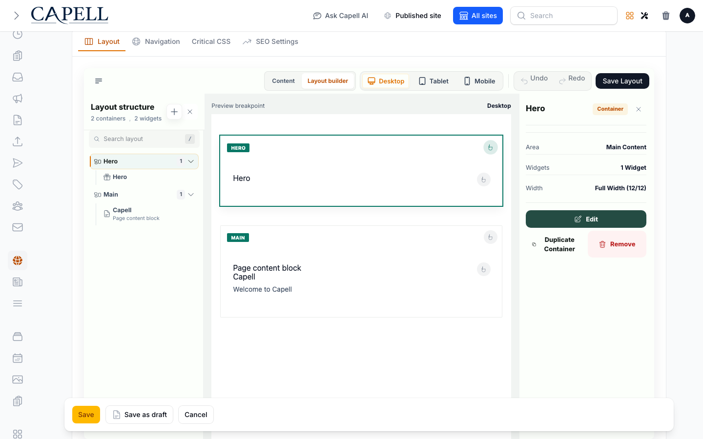
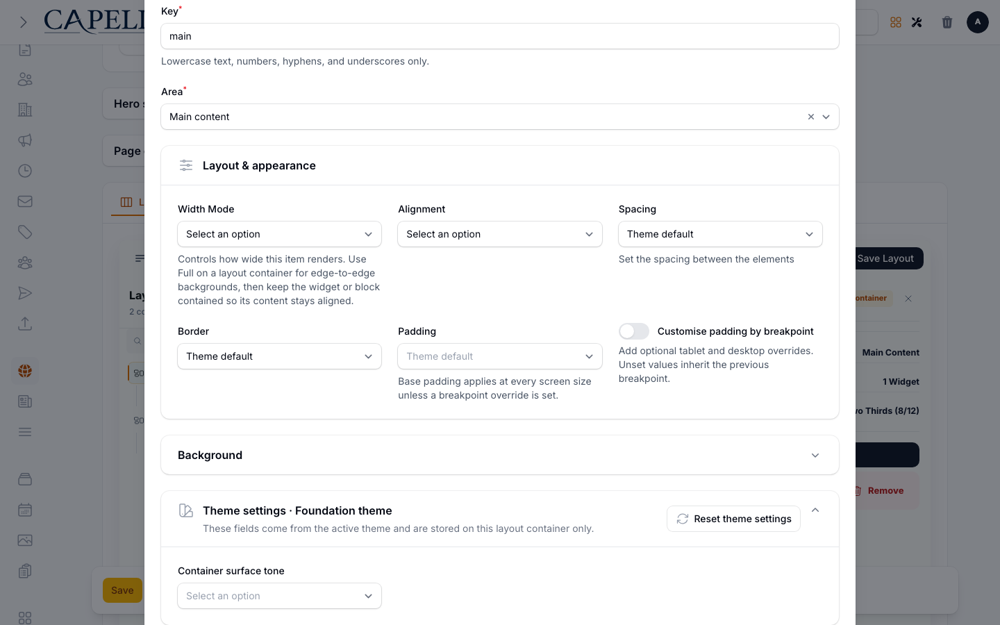

# Layout Builder

<!-- prettier-ignore-start -->

## What It Does

Layout Builder adds a visual page composition workflow with layout areas, widgets, reusable widgets, presets, and reversible layout edits.

- **Price and availability:** Check current availability and price on the [Capell Marketplace listing](https://capell.app/extensions/layout-builder).
- **Licence:** Check the licence terms on the [Capell Marketplace listing](https://capell.app/extensions/layout-builder).
- **Requires:** `PHP ^8.4`, `capell-app/admin ^1.0.72`, `capell-app/block-library ^1.0`, `capell-app/core ^1.0.76`, `capell-app/frontend ^1.0.72`.
- **Install:** `composer require capell-app/layout-builder`.

Editors can add, reorder, resize, and edit page widgets in admin. Visitors receive the saved layout graph as ordinary public output without authoring markers.

## Who It Is For

**For developers:** Registries and typed Actions provide stable extension points for widget definitions, layout widgets, presets, and public render data.

**For teams:** Choose Layout Builder when page composition changes; use Content Sections for reusable published sections or Structured Content Library for typed records such as testimonials and FAQs. Both can feed a Layout Builder composition. If a site only needs a few fixed templates, its existing Laravel templates may be enough.

## Quick Start

1. Install the package: `composer require capell-app/layout-builder`.
2. Run the package setup: `php artisan capell:layout-builder-install`.
3. Open the package admin surface at `/admin/layout-builder/widgets` and confirm Layout Builder is available.

## Configure

- **Configuration files:** `config/capell-layout-builder.php`.
- **Commands:** `php artisan capell:layout-builder-install`, `php artisan capell:layout-builder-widget-visual-regression`, `php artisan capell:layout-builder:prune-bulk-change-runs`, `php artisan capell:layouts:bulk-change`, `php artisan capell:widget-snapshots:prune`.

## Limits And Pitfalls

- Install the required Capell packages at the versions in `composer.json`: `capell-app/admin ^1.0.72`, `capell-app/block-library ^1.0`, `capell-app/core ^1.0.76`, `capell-app/frontend ^1.0.72`.
- Run migrations before opening package resources or public routes.
- Keep the host Laravel scheduler running so package-registered schedules can execute: `capell:layout-builder:prune-bulk-change-runs (daily; manifest declared)`, `capell:widget-snapshots:prune (daily; manifest declared)`.
- Keep public Blade and cached HTML free of authoring markers, model IDs, permissions, signed editor URLs, and lazy database queries.
- Custom write integrations must preserve invalidation for `layout-builder` cache tags.

## Screens And Workflow

## Content Composition

_The Page and its blueprint remain Core inputs. Layout Builder owns the areas, widget keys, widget definitions, and widget assets that `BuildPublicLayoutGraphAction` turns into a public layout graph; Frontend owns the final public render contract._

[Canonical Mermaid source](docs/images/content-composition.mmd)

What changes when you edit an article, its layout, or its theme? In this illustrative example, **A day on the coast** uses `main` for an article content widget and `sidebar` for a related-reading widget; these are example choices, not seeded defaults.

- **Content edit:** revise the article title or body in its blueprint-defined content; the example keeps its `main` and `sidebar` placements.
- **Layout edit:** move or reorder widget placements in the selected layout; this changes composition and may affect other pages sharing that layout.
- **Theme change:** change templates, typography, spacing and area presentation. Check the theme's available areas and widget support; switching themes does not guarantee an identical composition.

Source: [`BuildPublicLayoutGraphAction`](src/Actions/BuildPublicLayoutGraphAction.php) maps layout containers and ordered widgets into public data; [`LayoutLoader`](src/Support/Loader/LayoutLoader.php) resolves widgets and their assets. Page, Blueprint, Translation, Layout and Theme remain Core models; Widget and WidgetAsset belong to optional Layout Builder.

- Layout Builder visual editor with main and sidebar containers (admin).
- Layout Builder content-first editing mode (admin).
- Layout Builder add widget action (admin).
- Layout Builder add container action (admin).
- Layout Builder edit widget action (admin).
- Layout Builder edit container action (admin).
- Layout Builder active-theme container settings (admin).
- Layout Builder responsive padding controls on mobile (admin).
- Layout Builder active-theme container settings on mobile (admin).
- Layout Builder responsive preview (admin).
- Layout Builder tree selection (admin).
- Layout Builder filtered tree keyboard navigation (admin).
- Layout Builder preset action fixture (frontend).
- Layout Builder undo and redo actions fixture (frontend).
- Layout Builder native bulk-change criteria (admin).
- Layout Builder native bulk-change review (admin).
- Layout Builder main and sidebar public example (frontend).
- Layout Builder full-width public example (frontend).
- Widgets admin index (admin).
- Create and edit widget form with widget assets (admin).
- Unused and disabled widget integrity state (admin).
- Broken and unscoped widget asset integrity states (admin).
- Sections admin index (admin).
- Widgets admin index with admin sidebar menu open (admin).

## Works With

- [Content Sections](../content-sections/README.md): optional integration backed by the interop evidence map.
- [Frontend Authoring](../frontend-authoring/README.md): optional integration backed by the interop evidence map.
- [Publishing Studio](../publishing-studio/README.md): optional integration backed by the interop evidence map.
- [Structured Content Library](../structured-content-library/README.md): optional integration backed by the interop evidence map.
- [Theme Foundation](../theme-foundation/README.md): optional integration backed by the interop evidence map.

## Install Impact

- Required packages: `capell-app/core`, `capell-app/admin`, `capell-app/block-library`, `capell-app/frontend`.
- Admin navigation: declares `admin-resource: LayoutBuilderAdminRegistrar`; each Filament page or resource controls its own navigation visibility.
- Admin/editor extensions: `configurator: LayoutBuilderAdminRegistrar`, `schema-extender: LayoutBuilderAdminRegistrar`.
- Permissions: `ViewAny:Layout`, `View:Layout`, `Create:Layout`, `EditContent:Layout`, `EditLayout:Layout`, `Update:Layout`, `Delete:Layout`, `DeleteAny:Layout`, `Restore:Layout`, `ForceDelete:Layout`, `Replicate:Layout`, `Reorder:Layout`, `BulkMutate:Layout`; access also governed by package policies: `LayoutPresetPolicy`, `WidgetPolicy`.
- Public routes: registers `LayoutBuilderRoutesContribution`.
- Database changes: package migrations are declared.
- Config: `config/capell-layout-builder.php`.
- Settings: no package settings declared.
- Queues or schedules: scheduled commands `capell:layout-builder:prune-bulk-change-runs (daily; manifest declared)`, `capell:widget-snapshots:prune (daily; manifest declared)`; queue jobs `ApplyLayoutBulkChangeRunJob`, `SyncLinkedLayoutPresetJob`.
- Cache tags: `layout-builder`.
- Commands: `capell:layout-builder-install`, `capell:layout-builder-widget-visual-regression`, `capell:layout-builder:prune-bulk-change-runs`, `capell:layouts:bulk-change`, `capell:widget-snapshots:prune`.

## Troubleshooting

| Symptom | Likely cause | Check | Fix |
| --- | --- | --- | --- |
| Package surface is missing after install | Provider or manifest is not loaded | Confirm `capell.json`, package `composer.json`, and provider registration | Reinstall the package, refresh Composer autoload, and clear host caches |
| Admin screen or command fails on missing table | Package migrations have not run | Check the tables listed in `Data Model` | Run host migrations and rerun the focused package test |
| Background work does not run | Queue worker or declared schedule is not active | Check the jobs and scheduled commands listed in `Technical Shape` | Start the queue worker or host scheduler, then run the focused command or package test |
| Public output leaks unexpected state | Render data, cache variation, or authoring boundary has regressed | Check public Blade, cache tags, and public-output safety tests | Move data loading out of Blade and rerun the package public-output tests |

## Upgrading

No manual steps between minor versions.

Read [CHANGELOG.md](CHANGELOG.md) before upgrading.

## Next Steps

- [Package docs](docs/README.md)
- [Overview](docs/overview.md)
- [Worked extension examples](docs/extension-contracts.md)
- [Admin guide](docs/admin-guide.md)
- Configuration files: [`config/capell-layout-builder.php`](config/capell-layout-builder.php).
- [Troubleshooting](#troubleshooting)
- [Developer reference](docs/reference.md)
- [Marketplace assets](docs/assets/marketplace/)
- [Capell content language plan](../../docs/CONTENT_LANGUAGE_PLAN.md)
- [Capell documentation design system](../../docs/DESIGN_SYSTEM.md)
- [Capell and package ERD notes](../../docs/erd/capell-and-package-erds.md)
- Related packages: [Block Library](../block-library/README.md), [Content Sections](../content-sections/README.md), [Frontend Authoring](../frontend-authoring/README.md), [Publishing Studio](../publishing-studio/README.md), [Structured Content Library](../structured-content-library/README.md), [Foundation Theme](../theme-foundation/README.md).

<!-- prettier-ignore-end -->
